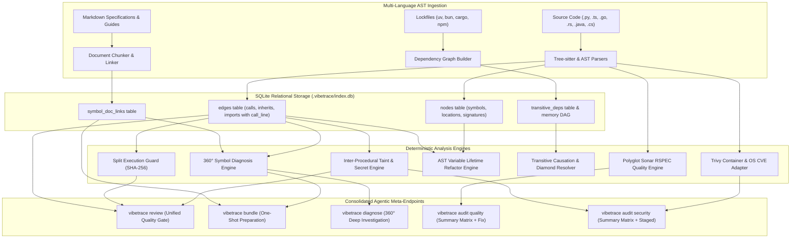
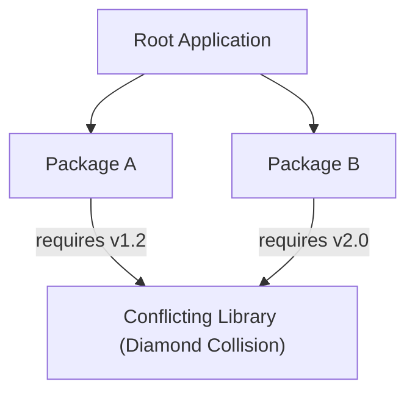
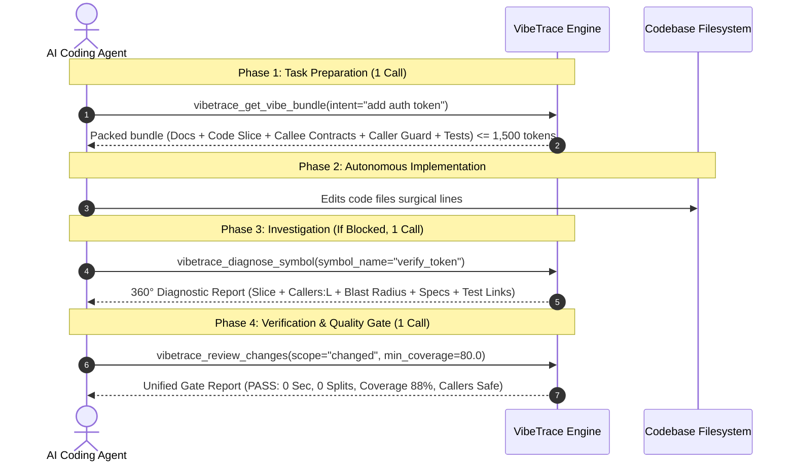

# 🧠 VibeTrace Core Intelligence Engines: Architecture & Algorithmic Specifications

## Executive Summary

VibeTrace treats a software codebase not as a bag of text tokens, but as an **executable relational nervous system**. Rather than relying exclusively on probabilistic vector embeddings—which hallucinate nonexistent call paths and drop parameter-level fidelity—VibeTrace builds deterministic AST relational graphs with exact 1-indexed call coordinates, inter-procedural taint reachability, inverted transitive lockfile dependency DAGs, and variable lifetime analyzers.

This document details the architectural specifications, mathematical models, and execution algorithms powering VibeTrace's core intelligence engines.



---

## 1. 🛡️ Inter-Procedural Taint Reachability Engine

Traditional AST SAST scanners emit localized warnings at injection sinks (e.g. `cursor.execute(query)`), leaving developers and agents blind to whether the sink is reachable from external user inputs (HTTP endpoints, CLI arguments, WebSocket messages).

### The Algorithmic Flow
The VibeTrace Taint Engine executes in three phases:

1. **Source & Sink Identification:**
   - **Sources:** Unsanitized parameters originating in HTTP route handlers (`FastAPI`, `Express`, `Next.js`, `Spring Boot`, `ASP.NET Core`), CLI arguments (`argparse`, `click`, `sys.argv`), or environment variables.
   - **Sinks:** Sensitive operations categorized by CWE standards:
     - `CWE-89`: SQL Injection (`cursor.execute`, `raw_sql`, ORM `extra()`)
     - `CWE-78`: Command Injection (`subprocess.Popen`, `os.system`, `child_process.exec`)
     - `CWE-22`: Path Traversal (`open()`, `Path.read_text`, `os.path.join` with user input)
     - `CWE-798`: Hardcoded credentials & high Shannon-entropy secrets
     - `CWE-502`: Insecure deserialization (`pickle.loads`, `yaml.unsafe_load`)
2. **Positional Argument-to-Parameter Propagation:**
   When function $f$ invokes function $g$ at call site line $L$:
   $$f(\dots, x, \dots) \xrightarrow[:L]{\text{calls}} g(\dots, p_i, \dots)$$
   The engine maps the $k$-th argument expression of the caller to the $k$-th parameter $p_k$ of the callee. If the argument is derived from a tainted variable, parameter $p_k$ is marked **tainted** inside $g$'s scope.
3. **Data Structure Taint Tracking:**
   Taint propagates across local dictionaries and tuple unpackings:
   ```python
   payload = {"query": user_input}  # Dictionary taint tracking
   q = payload["query"]              # Extracted key inherits taint
   db.execute(q)                     # Reaches sink -> ESCALATED
   ```
4. **Dynamic Severity Escalation:**
   - If a sink is **unreachable** from any entry point: Marked `LOW` or `MEDIUM` (dormant / internal utility).
   - If a sink has a **valid, unbroken execution path** from an external entry point: Dynamically escalated to `HIGH` or `CRITICAL`, accompanied by the full hop-by-hop tracepath with exact line numbers (`entrypoint:L12 -> route:L45 -> sink:L88`).

---

## 1b. 🛡️ Polyglot Security, Secrets & Optional Trivy Container Bridge

In addition to AST injection taint reachability, VibeTrace enforces a multi-tier security audit engine:

1. **Shannon Entropy & Modern API Token Scanner (`git_secret_scanner.py`):**
   - Real-time scanning for uncommitted API tokens (OpenAI, Anthropic, Mistral, Perplexity, Cohere, Tailscale, Postman, Supabase, GitHub, AWS).
   - Pre-commit staged blocker (`vibetrace audit security --staged`) that stops commits before secrets hit git history.
2. **Semgrep-Compatible Declarative Catalog Compiler (`rule_sync.py`):**
   - Native parsing and execution of Semgrep YAML rules directly against Tree-sitter AST, supporting `pattern`, `pattern-not` (negative assertions), and `pattern-inside` (scope enclosure).
   - Syncs CWE Top 25 and OWASP rules with a 3-day local cache, with zero external Python/CLI dependencies required.
3. **Optional Trivy Container & OS Package Adapter (`src/vibetrace/security/adapters/trivy.py`):**
   - Seamlessly auto-detects `trivy` on `$PATH` whenever container artifacts (`Dockerfile`, `docker-compose.yml`, `k8s/`) are present.
   - Scans compiled C/C++ libraries in base images (`glibc`, `openssl`, `libssl3`) via `trivy fs --format sarif` or explicit image scans `vibetrace audit security --image <tag>`.
   - Merges container findings into VibeTrace's universal Executive Findings Matrix and `.vibetrace/security.toml` baseline triage.

---

## 2. 🌳 Transitive Dependency Graph Resolution & Diamond Conflict Detection

When vulnerability scanners report a CVE in a deep sub-dependency (e.g. `certifi@2024.07.4`), AI agents typically hallucinate by attempting to manually upgrade the package in root manifests, which fails or gets overwritten during lockfile generation.

### Inverted DAG Representation
VibeTrace builds a directed acyclic graph $G = (V, E)$ from lockfiles (`uv.lock`, `package-lock.json`, `bun.lock`, `Cargo.lock`):
- **Nodes ($V$):** Package name, resolved version, and manifest provenance.
- **Edges ($E$):** Directed dependencies $A \to B$ ($A$ requires $B$).
- **Inverted Edges ($E^{-1}$):** Reverse adjacency list $\text{adj\_up}[B] = \{A \mid (A, B) \in E\}$.

### Root Causation Discovery (`deps why <pkg>`)
To find why target package $T$ is installed, the engine executes an inverted Breadth-First Search (BFS) starting from $T$ traversing up $E^{-1}$ until reaching direct root packages defined in top-level project manifests (`pyproject.toml`, `package.json`, `Cargo.toml`):

$$\text{Root Causation Chain: } \text{Manifest Root} \xrightarrow{} \text{Parent}_1 \xrightarrow{} \dots \xrightarrow{} \text{Target Package } T$$

This tells the agent immediately: *"Upgrade top-level dependency `httpx` to fix transitive vulnerability in `certifi`"*.

### Diamond Conflict Detection (`deps conflicts`)
A diamond dependency conflict occurs when two distinct packages in the dependency tree require incompatible versions of the same library:



The algorithm scans $G$:
1. Groups all resolved package nodes by normalized name.
2. If $|\text{versions}(P)| > 1$: Inspects incoming parents for each version.
3. Flags a **Diamond Conflict Report** detailing:
   - Distinct resolved versions.
   - Which parent packages demand each version.
   - Recommended unified target version satisfying constraint bounds.

---

## 3. ✂️ AST Variable Lifetime Analysis & Automated Method Extraction

When reducing cognitive complexity (SonarQube `python:S3776`), manually splitting large methods into helper functions frequently causes subtle scoping bugs when local variables are forgotten in argument lists or return tuples.

### Variable Lifetime Tracking (`_BlockUsageVisitor`)
The `RefactorService` inspects the AST of the target function using static variable lifetime analysis:

$$\text{Inputs} = \text{ReadBeforeWrite}(B) \cap (\text{FunctionParameters} \cup \text{PrecedingLocals})$$
$$\text{Outputs} = \text{ModifiedInBlock}(B) \cap \text{ReadDownstream}(B)$$

1. **Candidate Split Identification:**
   The analyzer scans the statement list of the function for contiguous blocks that yield a cognitive complexity reduction $\ge 3$.
2. **Pre-Flight Static Safety Verification:**
   The block is rejected from automated extraction if it contains constructs that alter execution control outside the function:
   - `yield` / `yield from` (generators cannot be naively extracted without breaking caller iterators).
   - `nonlocal` / `global` declarations.
   - Unhandled `break` / `continue` targeting loops outside the candidate block.
   - Return statements in the middle of the extracted statement slice.
3. **Automated Code Synthesis:**
   - **Helper Function:** Synthesizes `def helper_name(inputs):` containing the extracted body with properly adjusted indentation.
   - **Caller Call Site:** Replaces the original statement block with the drop-in call:
     ```python
     # If outputs is empty:
     helper_name(a, b)

     # If outputs has 1 variable:
     result = helper_name(a, b)

     # If outputs has multiple variables (tuple unpacking):
     total, count = helper_name(a, b)
     ```

---

## 3b. 🏆 Polyglot Code Quality & Sonar RSPEC Parity Engine

To combat cognitive degradation and code smells without requiring a monolithic SonarQube server, VibeTrace implements a dual-tier quality architecture:

1. **Native Tree-sitter AST Rules:**
   - Evaluates Cognitive Complexity (`RSPEC-3776`), Deep Nesting (`RSPEC-134`), String Duplication (`RSPEC-1192`), and Async Without Await (`RSPEC-7503`) in $<15\text{ms}$.
   - Runs identically across Python, JavaScript, TypeScript, Go, and Rust.
2. **Two-Step "Target & Verify" Remediation Workflow:**
   - **Step 1: Executive Findings Matrix (`--summary`):** Emits a `< 1 KB` high-density matrix summarizing findings by severity, rule ID, unapproved counts, and top impacted files. Completely eliminates terminal truncation and AI context window overflow.
   - **Step 2: Surgical JSON Extraction (`--file <path> --json`):** Emits machine-readable JSON containing exact line spans, code snippets, compliant solutions, and remediation advice for automated AI patching.
3. **Automated Safe Codemods (`--fix`):**
   - Integrates ecosystem linters (Ruff, Biome, Pint, SQLFluff) and native AST codemods to automatically fix deterministic smells in-place.
4. **OASIS SARIF 2.1.0 Export (`--sarif`):**
   - Directly uploads quality and security findings into GitHub Pull Request review checks and IDEs without third-party plugins.

## 4. 🔗 Live Codebase Symbol $\leftrightarrow$ Documentation Bi-Directional Linking

Documentation specifications drift silently over time as functions are refactored, renamed, or deleted.

### Bi-Directional Inverted Indexing
1. **Cold Indexing & Sync (`vibetrace docs sync-links`):**
   - The engine parses markdown catalogs, extracting backticked symbols (e.g. `` `IndexerDB.upsert_node` ``) and linking them to AST nodes in SQLite (`symbol_doc_links` table).
   - Filters out generic language keywords (`None`, `True`, `class`, `dict`, `error`) to eliminate noise.
2. **Context Window Token Budgeting:**
   When an agent slices a symbol via `vibetrace slice` or `vibetrace bundle`, the linker queries `symbol_doc_links`. It attaches the relevant markdown heading and specification text, capping documentation injection strictly to $\le 300$ tokens to protect the LLM context ceiling.
3. **Drift Detection Gate (`vibetrace docs check`):**
   Audits all documented symbols against the live AST index. If a markdown specification references a function that no longer exists in code, the gate alerts the agent with the exact markdown line and suggests closest matching symbols based on Levenshtein distance.

---

## 5. 🎯 Dynamic Test Fixture Reachability

Standard static call-graph analyzers fail when tests are invoked dynamically through framework fixtures and runners, falsely reporting functions as having 0% test coverage.

### Decorator & Argument AST Binding
VibeTrace's language parsers (`python_parser.py`, `js_parser.py`) implement framework-aware AST hooks:
- **Pytest:** Detects `@pytest.fixture`, `@pytest.mark.parametrize("param", [...])`. Binds parameter usages to downstream function arguments.
- **Jest / Vitest:** Resolves `describe.each(...)`, `test.each(...)`, and `it.each(...)` parameter iterations, linking call edges from test suites to domain functions.
- **Quality Gate Integration:** Eliminates false alarms in the pre-commit review gate (`vibetrace review`), ensuring that functions tested via parameterized fixtures are recognized as covered.

---

## 6. 🚀 The Agentic Meta-Endpoints Philosophy

In multi-turn agentic workflows, conversational round-trips are the primary bottleneck to speed, reliability, and cost. VibeTrace provides **3 Core Agentic Meta-Endpoints** designed to solve the three core phases of AI pair programming in exactly **1 call per phase**:



1. **`vibetrace_get_vibe_bundle` (Preparation):**
   Replaces 5 separate tool calls (`docs search`, `semantic search`, `slice`, `guard`, `dependencies`) with one bounded context packet.
2. **`vibetrace_diagnose_symbol` (Investigation):**
   Replaces 4 separate tool calls (`slice`, `call-stack`, `impact`, `docs check`) with a single 360° diagnostic dossier.
3. **`vibetrace_review_changes` (Verification):**
   Replaces 4 separate quality gates with a single pre-commit pass enforcing security, taint, split integrity, caller safety, and 80% test coverage.
