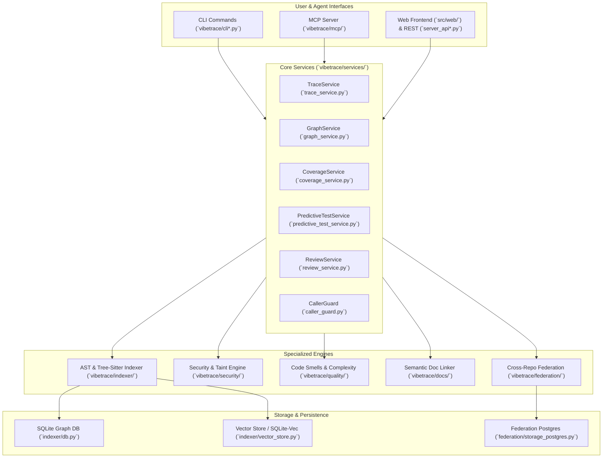

# VibeTrace Architecture & Module Catalog

This document provides a comprehensive, structured reference of all modules and components across the VibeTrace codebase, detailing their responsibilities, primary entry points, interactions, and design patterns.

---

## 🏗️ High-Level System Architecture

VibeTrace is organized into layered subsystems centered around code intelligence, static symbolic graph exploration, taint analysis, predictive testing, and agent interfaces (MCP + CLI + Web UI):

---

## 📦 Module Directory Catalog

| Subsystem / Directory | Path | Primary Purpose |
| :--- | :--- | :--- |
| **CLI & Entrypoints** | [`src/vibetrace/cli*.py`](file:///i:/01-Master_Code/Apps/VibeGraph/src/vibetrace/) | CLI arguments parsing, command dispatchers, human-readable terminal formatters, and exit codes. |
| **Server & REST APIs** | [`src/vibetrace/server_api*.py`](file:///i:/01-Master_Code/Apps/VibeGraph/src/vibetrace/) | Standalone lightweight HTTP server exposing REST endpoints for the Web UI and IDE plugins. |
| **Core Services** | [`src/vibetrace/services/`](file:///i:/01-Master_Code/Apps/VibeGraph/src/vibetrace/services/) | Domain workflows: path tracing, graph queries, predictive testing, caller guarding, review scoring, and repo map generation. |
| **Indexer Subsystem** | [`src/vibetrace/indexer/`](file:///i:/01-Master_Code/Apps/VibeGraph/src/vibetrace/indexer/) | Multi-language Tree-sitter parsers, SQLite schema, cross-file symbol resolution, vector embeddings, and file system watchers. |
| **Security & Taint Engine** | [`src/vibetrace/security/`](file:///i:/01-Master_Code/Apps/VibeGraph/src/vibetrace/security/) | Static AST vulnerability checks, interprocedural Def-Use taint tracking, dependency auditing (OSV), IaC scanning, and secrets detection. |
| **Quality Engine** | [`src/vibetrace/quality/`](file:///i:/01-Master_Code/Apps/VibeGraph/src/vibetrace/quality/) | Cognitive/cyclomatic complexity, code smells, duplication detection, Dockerfile/Kubernetes linting, and automated codemods. |
| **Documentation & RAG** | [`src/vibetrace/docs/`](file:///i:/01-Master_Code/Apps/VibeGraph/src/vibetrace/docs/) | Documentation chunking, FTS5 markdown indexing, and bidirectional symbol-to-document linking (`symbol_doc_links`). |
| **Federation Subsystem** | [`src/vibetrace/federation/`](file:///i:/01-Master_Code/Apps/VibeGraph/src/vibetrace/federation/) | Enterprise multi-repository index synchronization, cross-repo dependency resolution, and centralized PostgreSQL backend. |
| **Model Context Protocol (MCP)** | [`src/vibetrace/mcp/`](file:///i:/01-Master_Code/Apps/VibeGraph/src/vibetrace/mcp/) | FastMCP server exposing token-efficient tools for AI assistants (Antigravity, Cursor, Claude Desktop). |
| **Refactoring Engine** | [`src/vibetrace/refactor/`](file:///i:/01-Master_Code/Apps/VibeGraph/src/vibetrace/refactor/) | AST-safe refactoring models and automated symbol renaming/patching. |
| **Web UI Dashboard** | [`src/web/`](file:///i:/01-Master_Code/Apps/VibeGraph/src/web/) | React + TypeScript interactive Map Room, dependency visualizer, and code intelligence dashboard. |

---

## 🔍 Detailed Module Breakdown

### 1. Indexer Subsystem (`src/vibetrace/indexer/`)

Handles scanning project source trees, parsing code with Tree-sitter, persisting nodes and edges to SQLite, and generating vector embeddings.

* [`db.py`](file:///i:/01-Master_Code/Apps/VibeGraph/src/vibetrace/indexer/db.py): Core SQLite database manager (`IndexerDB`). Manages schema creation, transactional writes, WAL configuration, node/edge persistence, cascading cleanup, and orphaned edge pruning.
* [`db_queries.py`](file:///i:/01-Master_Code/Apps/VibeGraph/src/vibetrace/indexer/db_queries.py): Complex analytical SQL queries including native SQLite recursive Common Table Expressions (`find_path_recursive_cte`), full-text search (FTS5), and symbol lookups.
* [`db_retry.py`](file:///i:/01-Master_Code/Apps/VibeGraph/src/vibetrace/indexer/db_retry.py): Concurrency retry decorator (`@with_write_retry`) with exponential backoff and jitter for resilient multi-process database access.
* [`schema.sql`](file:///i:/01-Master_Code/Apps/VibeGraph/src/vibetrace/indexer/schema.sql): DDL defining relational tables: `nodes`, `edges`, `indexed_files`, `file_imports`, `edge_targets`, `symbol_doc_links`, `function_taint_contracts`, and `meta`.
* [`main.py`](file:///i:/01-Master_Code/Apps/VibeGraph/src/vibetrace/indexer/main.py): High-level workspace indexing orchestration: single-file vs. batch indexing, multi-threaded directory walking, and incremental content-hash checks.
* [`resolver.py`](file:///i:/01-Master_Code/Apps/VibeGraph/src/vibetrace/indexer/resolver.py): Cross-file import path resolution for Python modules, JavaScript/TypeScript barrel files, and Go package directories.
* [`lsp_bridge.py`](file:///i:/01-Master_Code/Apps/VibeGraph/src/vibetrace/indexer/lsp_bridge.py): Hybrid LSP bridge connecting to local language servers (`basedpyright`, `gopls`, `rust-analyzer`) to rewire polymorphic and re-exported call targets that static AST cannot resolve alone.
* [`embeddings.py`](file:///i:/01-Master_Code/Apps/VibeGraph/src/vibetrace/indexer/embeddings.py) & [`vector_store.py`](file:///i:/01-Master_Code/Apps/VibeGraph/src/vibetrace/indexer/vector_store.py): 256-dimensional Matryoshka vector embeddings generation and similarity search via `sqlite-vec` or raw SQLite fallback.
* [`watcher.py`](file:///i:/01-Master_Code/Apps/VibeGraph/src/vibetrace/indexer/watcher.py): Background file system watcher (`watchdog`) for instant incremental index synchronization on file change or deletion.
* [`git_utils.py`](file:///i:/01-Master_Code/Apps/VibeGraph/src/vibetrace/indexer/git_utils.py): Git repository interrogation: discovering root directories, changed files in working tree, and commit diffs.
* [`scip_importer.py`](file:///i:/01-Master_Code/Apps/VibeGraph/src/vibetrace/indexer/scip_importer.py): Ingestion of SCIP index protobufs for language-server-grade indexing accuracy.
* **Language Parsers** ([`parsers/`](file:///i:/01-Master_Code/Apps/VibeGraph/src/vibetrace/indexer/parsers/)):
  * [`base.py`](file:///i:/01-Master_Code/Apps/VibeGraph/src/vibetrace/indexer/parsers/base.py): Base `TreeSitterParser` defining symbol scoping, AST traversal, call resolution, and builtin filtering.
  * [`python_parser.py`](file:///i:/01-Master_Code/Apps/VibeGraph/src/vibetrace/indexer/parsers/python_parser.py): Python AST and Tree-sitter extractor for functions, classes, decorators, calls, and imports.
  * [`js_parser.py`](file:///i:/01-Master_Code/Apps/VibeGraph/src/vibetrace/indexer/parsers/js_parser.py): JavaScript, TypeScript, and TSX/JSX parser for ES modules, React components, and arrow functions.
  * [`go_parser.py`](file:///i:/01-Master_Code/Apps/VibeGraph/src/vibetrace/indexer/parsers/go_parser.py): Go language parser supporting struct embedding, interface definitions, receiver methods, and package-level sibling functions.
  * [`rust_parser.py`](file:///i:/01-Master_Code/Apps/VibeGraph/src/vibetrace/indexer/parsers/rust_parser.py): Rust parser extracting structs, enums, traits, `impl` blocks, and macro invocations.
  * [`generic_parser.py`](file:///i:/01-Master_Code/Apps/VibeGraph/src/vibetrace/indexer/parsers/generic_parser.py): Universal grammar fallback parser supporting Java, C#, C, C++, and PHP.
  * [`route_extractor.py`](file:///i:/01-Master_Code/Apps/VibeGraph/src/vibetrace/indexer/parsers/route_extractor.py): Web framework HTTP route extractor (FastAPI, Flask, Express, NestJS, Gin, Echo, Actix, Spring Boot).

---

### 2. Core Services (`src/vibetrace/services/`)

Exposes high-level business capabilities consumed by both CLI commands and MCP agent tools.

* [`trace_service.py`](file:///i:/01-Master_Code/Apps/VibeGraph/src/vibetrace/services/trace_service.py): Traces shortest execution paths between symbols using SQLite recursive CTEs (`find_path_recursive_cte`), detects branching split points, and outputs structured hops.
* [`graph_service.py`](file:///i:/01-Master_Code/Apps/VibeGraph/src/vibetrace/services/graph_service.py): Call stack builder (`vibetrace_get_call_stack`), symbol dependency lookups, caller/callee traversal, and references search.
* [`caller_guard.py`](file:///i:/01-Master_Code/Apps/VibeGraph/src/vibetrace/services/caller_guard.py): Pre-refactoring safety check. Scans all direct and transitive callers of a target function and highlights call sites requiring modification.
* [`coverage_service.py`](file:///i:/01-Master_Code/Apps/VibeGraph/src/vibetrace/services/coverage_service.py): Hybrid test coverage engine. Computes AST-level symbol coverage (test caller reachability) combined with Cobertura/LCOV line-hit verification.
* [`predictive_test_service.py`](file:///i:/01-Master_Code/Apps/VibeGraph/src/vibetrace/services/predictive_test_service.py): Intelligent test selection based on Git diffs. Discovers which unit tests must run to validate changed functions without executing the full test suite.
* [`review_service.py`](file:///i:/01-Master_Code/Apps/VibeGraph/src/vibetrace/services/review_service.py): Orchestrates unified PR and commit code reviews, combining security findings, code smells, test gaps, and coverage quality gates into an action-oriented Markdown report.
* [`repo_map_service.py`](file:///i:/01-Master_Code/Apps/VibeGraph/src/vibetrace/services/repo_map_service.py): Generates compact, token-budgeted repository maps with centrality-weighted symbols, ideal for seeding AI agent context windows.
* [`split_audit_service.py`](file:///i:/01-Master_Code/Apps/VibeGraph/src/vibetrace/services/split_audit_service.py): Audits branching logic, identifying conditional divergence, exception branches, and untraced error flows.
* [`vibe_bundle.py`](file:///i:/01-Master_Code/Apps/VibeGraph/src/vibetrace/services/vibe_bundle.py): Context bundling utility that aggregates target symbols, their direct dependencies, docstrings, and tests into a self-contained token-optimized context pack.
* [`call_tree_service.py`](file:///i:/01-Master_Code/Apps/VibeGraph/src/vibetrace/services/call_tree_service.py): Constructs hierarchical caller/callee trees up to configurable depth limits.
* [`diagnose_service.py`](file:///i:/01-Master_Code/Apps/VibeGraph/src/vibetrace/services/diagnose_service.py): Diagnostic health check (`vibetrace doctor`) verifying database integrity, tree-sitter binaries, and index completeness.
* [`reindex_service.py`](file:///i:/01-Master_Code/Apps/VibeGraph/src/vibetrace/services/reindex_service.py): Executes workspace or single-file reindexing, embedding generation, documentation sync, and edge pruning.
* [`hybrid_search.py`](file:///i:/01-Master_Code/Apps/VibeGraph/src/vibetrace/services/hybrid_search.py): Blended search combining exact lexical name matching, FTS5 documentation search, and Matryoshka vector cosine similarity.
* [`saved_traces_service.py`](file:///i:/01-Master_Code/Apps/VibeGraph/src/vibetrace/services/saved_traces_service.py): Manages persistent trace bookmarks and named execution flows in SQLite.

---

### 3. Security Subsystem (`src/vibetrace/security/`)

Static Application Security Testing (SAST), taint analysis, secrets detection, and supply chain audit.

* [`taint_engine.py`](file:///i:/01-Master_Code/Apps/VibeGraph/src/vibetrace/security/taint_engine.py): Call-graph taint reachability analyzer. Performs multi-path reverse BFS from dangerous sinks (SQL execution, command injection, path traversal) back to untrusted sources (HTTP handlers, CLI arguments), escalating finding severities.
* [`dataflow.py`](file:///i:/01-Master_Code/Apps/VibeGraph/src/vibetrace/security/dataflow.py): Interprocedural and intraprocedural Def-Use dataflow engine. Tracks variable assignments, dictionary accesses, in-place mutations (`append`/`extend`), and parameter propagations across call sites.
* [`contracts.py`](file:///i:/01-Master_Code/Apps/VibeGraph/src/vibetrace/security/contracts.py): `FunctionTaintContract` manager. Caches whether functions act as sanitizers or propagate taint between arguments and return values.
* [`ast_scanner.py`](file:///i:/01-Master_Code/Apps/VibeGraph/src/vibetrace/security/ast_scanner.py): AST pattern matcher checking for OWASP Top 10 vulnerabilities (CWE-89, CWE-78, CWE-22, CWE-79, CWE-502).
* [`git_secret_scanner.py`](file:///i:/01-Master_Code/Apps/VibeGraph/src/vibetrace/security/git_secret_scanner.py): High-entropy secret and token detector scanning Git diffs and patch streams using Shannon entropy and regex token signatures.
* [`iac_scanner.py`](file:///i:/01-Master_Code/Apps/VibeGraph/src/vibetrace/security/iac_scanner.py): Zero-dependency Infrastructure-as-Code (IaC) scanner for Dockerfile, Docker Compose, and GitHub Actions workflows.
* [`dep_graph.py`](file:///i:/01-Master_Code/Apps/VibeGraph/src/vibetrace/security/dep_graph.py) & [`lockfile_parser.py`](file:///i:/01-Master_Code/Apps/VibeGraph/src/vibetrace/security/lockfile_parser.py): Parses dependency manifests (`package-lock.json`, `poetry.lock`, `uv.lock`, `Cargo.lock`, `go.sum`) to build dependency trees.
* [`osv_client.py`](file:///i:/01-Master_Code/Apps/VibeGraph/src/vibetrace/security/osv_client.py): Queries Google Open Source Vulnerabilities (OSV) database for known CVEs affecting project dependencies with local disk caching.
* [`rule_sync.py`](file:///i:/01-Master_Code/Apps/VibeGraph/src/vibetrace/security/rule_sync.py) & [`rules.py`](file:///i:/01-Master_Code/Apps/VibeGraph/src/vibetrace/security/rules.py): Offline-first declarative security rules catalog manager with SHA-256 verification and TTL-based updates.
* [`sarif_ingest.py`](file:///i:/01-Master_Code/Apps/VibeGraph/src/vibetrace/security/sarif_ingest.py): Ingests external SARIF reports (Semgrep, CodeQL, Trivy) and correlates findings with the VibeTrace graph.
* [`auto_patcher.py`](file:///i:/01-Master_Code/Apps/VibeGraph/src/vibetrace/security/auto_patcher.py): Generates minimal AST-safe code patches to fix detected security vulnerabilities.
* [`baseline.py`](file:///i:/01-Master_Code/Apps/VibeGraph/src/vibetrace/security/baseline.py): Manages security baselines in `.vibetrace/security.toml` to suppress legacy debt and focus on new regressions.

---

### 4. Quality Subsystem (`src/vibetrace/quality/`)

Measures code health, cyclomatic/cognitive complexity, and anti-patterns.

* [`smells.py`](file:///i:/01-Master_Code/Apps/VibeGraph/src/vibetrace/quality/smells.py): Detects code smells including God classes, long parameter lists, excessive function length, feature envy, and deep nesting.
* [`treesitter_complexity.py`](file:///i:/01-Master_Code/Apps/VibeGraph/src/vibetrace/quality/treesitter_complexity.py) & [`complexity.py`](file:///i:/01-Master_Code/Apps/VibeGraph/src/vibetrace/quality/complexity.py): Calculates Sonar-grade Cognitive Complexity and McCabe Cyclomatic Complexity across Python, JS/TS, Go, Rust, Java, and C#.
* [`literal_duplication.py`](file:///i:/01-Master_Code/Apps/VibeGraph/src/vibetrace/quality/literal_duplication.py): Detects duplicate magic literals and hardcoded strings across files.
* [`css_analyzer.py`](file:///i:/01-Master_Code/Apps/VibeGraph/src/vibetrace/quality/css_analyzer.py): Lints CSS/Tailwind usage for unbounded arbitrary values and specificity issues.
* [`docker_analyzer.py`](file:///i:/01-Master_Code/Apps/VibeGraph/src/vibetrace/quality/docker_analyzer.py) & [`k8s_analyzer.py`](file:///i:/01-Master_Code/Apps/VibeGraph/src/vibetrace/quality/k8s_analyzer.py): Analyzes Dockerfile and Kubernetes YAML manifests for production best practices.
* [`rules_catalog.py`](file:///i:/01-Master_Code/Apps/VibeGraph/src/vibetrace/quality/rules_catalog.py): Built-in native quality rules catalog covering structural AST/Call-Graph rules (Cognitive Complexity, Deep Nesting, Unused Private Methods, etc.).
* [`rules.py`](file:///i:/01-Master_Code/Apps/VibeGraph/src/vibetrace/quality/rules.py): In-memory resolution and vendor alias mapping for native quality rule specifications.
* [`codemods.py`](file:///i:/01-Master_Code/Apps/VibeGraph/src/vibetrace/quality/codemods.py): Automated code transformations and style cleanups.
* [`baseline.py`](file:///i:/01-Master_Code/Apps/VibeGraph/src/vibetrace/quality/baseline.py): Quality baseline storage in `.vibetrace/quality.toml`.

---

### 5. Documentation Subsystem (`src/vibetrace/docs/`)

Enables semantic RAG over markdown documentation and synchronizes code symbols with technical docs.

* [`chunker.py`](file:///i:/01-Master_Code/Apps/VibeGraph/src/vibetrace/docs/chunker.py): Hierarchical markdown chunker slicing documents by headings while preserving breadcrumbs.
* [`symbol_linker.py`](file:///i:/01-Master_Code/Apps/VibeGraph/src/vibetrace/docs/symbol_linker.py): Bidirectional linking engine associating code symbols with relevant documentation chunks.
* [`db.py`](file:///i:/01-Master_Code/Apps/VibeGraph/src/vibetrace/docs/db.py): Documentation SQLite database with FTS5 search.
* [`service.py`](file:///i:/01-Master_Code/Apps/VibeGraph/src/vibetrace/docs/service.py): Manages local and shared documentation catalogs.

---

### 6. Federation Subsystem (`src/vibetrace/federation/`)

Enterprise multi-repository index federation.

* [`project.py`](file:///i:/01-Master_Code/Apps/VibeGraph/src/vibetrace/federation/project.py): Federation workspace coordinator.
* [`cross_repo_linker.py`](file:///i:/01-Master_Code/Apps/VibeGraph/src/vibetrace/federation/cross_repo_linker.py): Resolves remote dependencies and cross-repo API calls.
* [`storage.py`](file:///i:/01-Master_Code/Apps/VibeGraph/src/vibetrace/federation/storage.py): Centralized SQLite storage for multi-repo workspace mode.
* [`storage_postgres.py`](file:///i:/01-Master_Code/Apps/VibeGraph/src/vibetrace/federation/storage_postgres.py): Scalable PostgreSQL storage backend for enterprise deployments.

---

### 7. MCP Subsystem (`src/vibetrace/mcp/`)

Model Context Protocol interface empowering AI coding agents with surgical code intelligence tools.

* [`server.py`](file:///i:/01-Master_Code/Apps/VibeGraph/src/vibetrace/mcp/server.py): FastMCP server declaring read-only, idempotent tools: `vibetrace_trace_execution_path`, `vibetrace_get_call_stack`, `vibetrace_get_symbol_definition`, `vibetrace_hybrid_search`, etc.
* [`schemas.py`](file:///i:/01-Master_Code/Apps/VibeGraph/src/vibetrace/mcp/schemas.py): Pydantic input/output schemas validating all agent arguments.
* [`formatters.py`](file:///i:/01-Master_Code/Apps/VibeGraph/src/vibetrace/mcp/formatters.py): Markdown and JSON formatters optimized to minimize token consumption.
* [`tools_engineering.py`](file:///i:/01-Master_Code/Apps/VibeGraph/src/vibetrace/mcp/tools_engineering.py): Tools for caller guards, predictive testing, and test coverage checks.
* [`tools_project.py`](file:///i:/01-Master_Code/Apps/VibeGraph/src/vibetrace/mcp/tools_project.py): Tools for project topology and multi-repo exploration.

---

### 8. CLI & Server Presentation (`src/vibetrace/`)

Terminal and Web API dispatchers.

* [`cli.py`](file:///i:/01-Master_Code/Apps/VibeGraph/src/vibetrace/cli.py): Main argparse CLI entry point (`vibetrace index`, `trace`, `audit`, `review`, `doctor`, `mcp`, `serve`).
* [`cli_commands.py`](file:///i:/01-Master_Code/Apps/VibeGraph/src/vibetrace/cli_commands.py): Command execution handlers for indexing, tracing, and symbol lookup.
* [`cli_audit.py`](file:///i:/01-Master_Code/Apps/VibeGraph/src/vibetrace/cli_audit.py): Handlers for security, quality, and comprehensive code review commands.
* [`server_api.py`](file:///i:/01-Master_Code/Apps/VibeGraph/src/vibetrace/server_api.py): Python `http.server` backend powering the interactive web Map Room and REST client.
