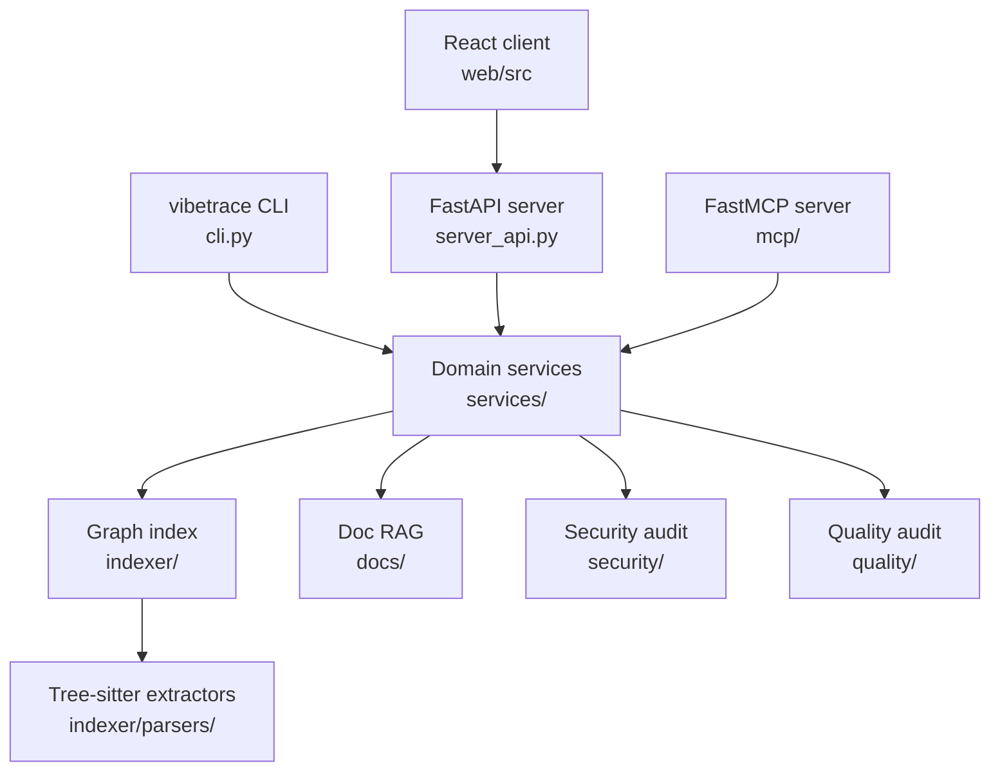

# src Blueprint

## System Overview

This subtree holds the two runnable halves of VibeTrace:

- `vibetrace` - the Python package. It owns the command line interface, the FastAPI
  HTTP server, the FastMCP server, and the analysis subsystems (indexing, security,
  quality, documentation RAG, federation). The CLI and the API server are two
  front ends over one service layer, and both read and write one local index
  database.
- `web` - the React client. It renders the architecture map, the unified review
  dashboard, and the documentation workspace. It holds no analysis logic; it reads
  the same data through the HTTP API exposed by `vibetrace/server_api.py` and
  receives live updates over the `/ws` channel.

## Subdirectories & System Boundaries

- [vibetrace](./vibetrace/README.md) - Python package: CLI entry point, FastAPI
  server, MCP server, project configuration, and the analysis subsystems below it.
- [web](./web/README.md) - Vite plus React client for the architecture map, the
  unified quality gate dashboard, and the documentation workspace.

## Global Invariants

- The CLI, HTTP API, and MCP server are three front ends over the same domain
  services in `src/vibetrace/services`, so a change to graph traversal, tracing, or
  review behavior must land in that package rather than in one front end
  (`[src/vibetrace/services/README.md]`).
- The web client holds no analysis logic. Every finding, split, and coverage number
  it displays comes from the HTTP API in `src/vibetrace/server_api.py`
  (`[src/web/src/features/dashboard/components/README.md]`).
- The index database is the shared state between subsystems. Security, quality, and
  documentation packages read and write tables owned by the indexer schema
  (`[src/vibetrace/indexer/README.md]`, `[src/vibetrace/indexer/schema.sql]`).
- Baseline state for reviews is version controlled: splits in `.vibetrace/splits.toml`,
  security exceptions in `.vibetrace/security.toml`, and quality exceptions in
  `.vibetrace/quality.toml`
  (`[src/vibetrace/services/split_audit_service.py:get_splits_toml_path]`,
  `[src/vibetrace/security/baseline.py:SecurityBaselineManager]`,
  `[src/vibetrace/quality/baseline.py:QualityBaselineManager]`).
- Audit and review commands are non destructive by default. Findings are approved
  explicitly, and refactoring and dependency patching require an explicit apply
  flag (`[src/vibetrace/mcp/schemas.py:RefactorMethodInput]`,
  `[src/vibetrace/mcp/schemas.py:PatchDependencyInput]`).

## Global Side Effects

- The shared index database is created and migrated under `.vibetrace/`
  (`[src/vibetrace/indexer/db.py:IndexerDB]`).
- Network access happens in the OSV vulnerability lookup, the remote rule catalog
  sync, the pull request review bot, and the first run embedding model download
  (`[src/vibetrace/security/osv_client.py:OsvClient]`,
  `[src/vibetrace/security/rule_sync.py:RuleCatalogManager]`,
  `[src/vibetrace/security/pr_bot.py:PRTaintBot]`,
  `[src/vibetrace/indexer/embeddings.py:EmbeddingEngine]`).
- Git is invoked as a subprocess for staged diffs, changed file detection, and hook
  installation (`[src/vibetrace/services/caller_guard.py:CallerGuardService]`,
  `[src/vibetrace/indexer/git_utils.py:get_git_sha]`).
- Optional external scanners and linters run as subprocesses when installed
  (`[src/vibetrace/security/adapters/README.md]`,
  `[src/vibetrace/quality/adapters/README.md]`).
- The web client keeps a WebSocket connection open to the API server and writes to
  the clipboard for agent prompts and context bundles
  (`[src/web/src/features/map-room/hooks/useVibeSync.ts]`,
  `[src/web/src/features/map-room/components/VibeBundleButton.tsx]`).

## System Verification

- Run: `uv run pytest`
- Run: `cd src/web && bun run build`
- Run: `cd src/web && bun run test:e2e`
